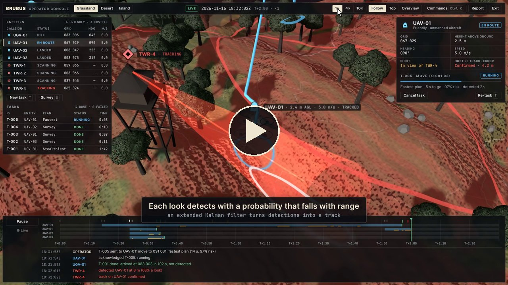
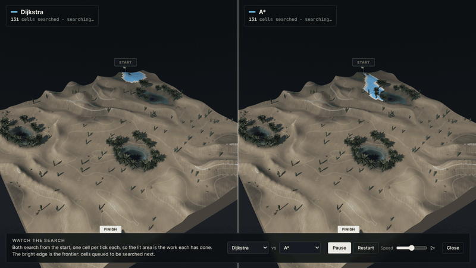
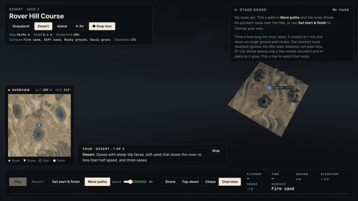
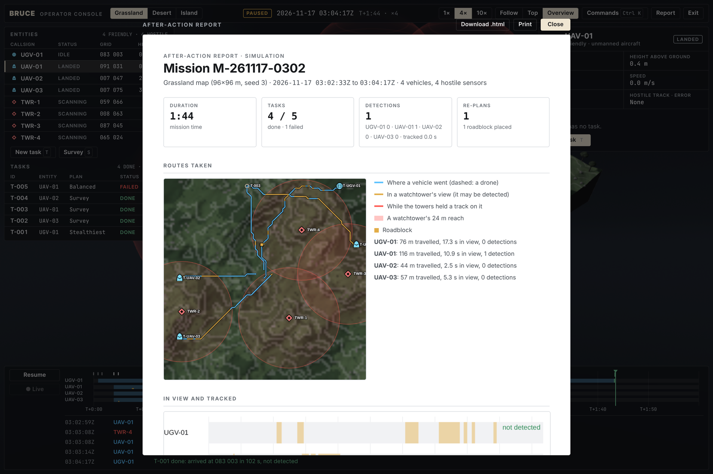
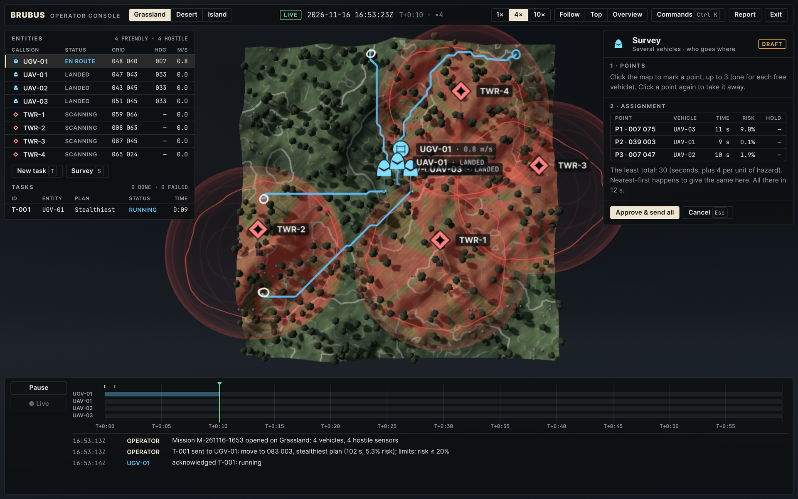
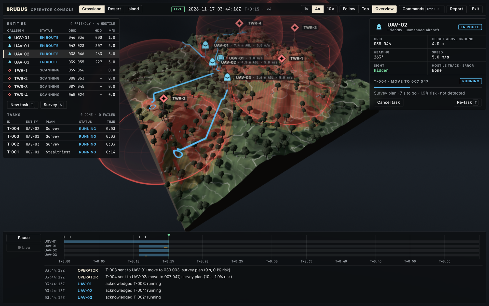
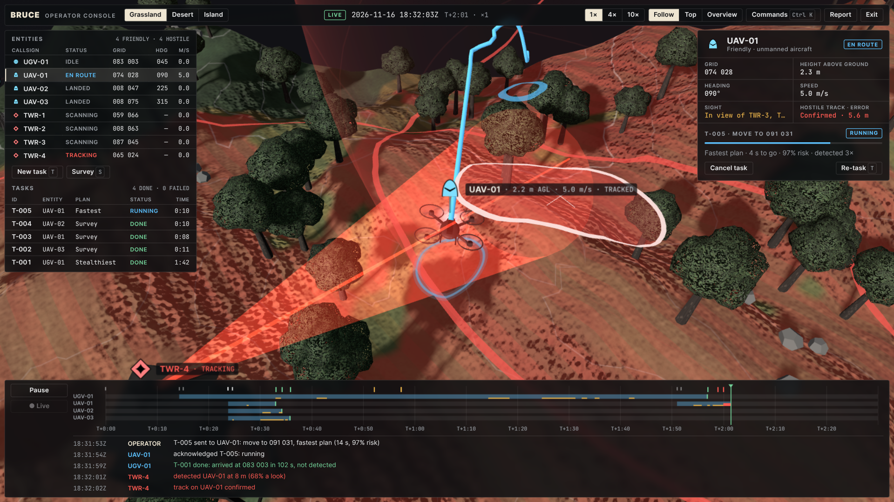
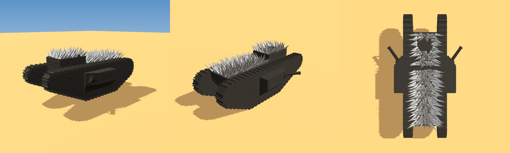
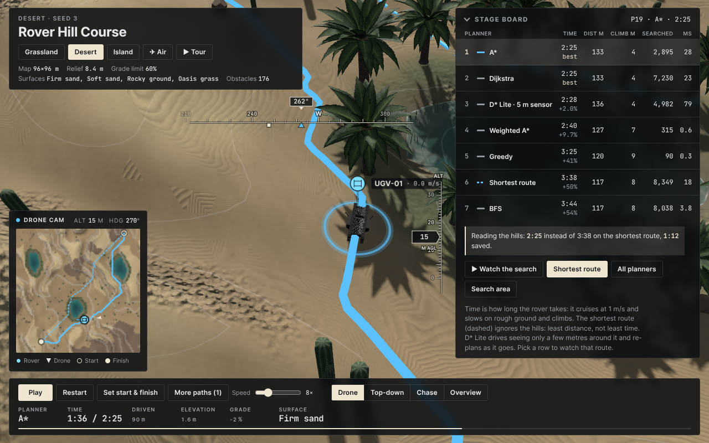

# Rover Hill Course — 3D Off-Road Robot Navigation

[](https://github.com/R0CK574R/brubus/actions/workflows/ci.yml)

**[▶ Open the live demo](https://r0ck574r.github.io/brubus/)**: it runs in your browser, on a laptop or a phone,
with nothing to install. Press **▶ Tour** for a guided run through all three maps (about two minutes).

[](https://r0ck574r.github.io/brubus/brubus-demo.mp4)

**[▶ Watch the demo video](https://r0ck574r.github.io/brubus/brubus-demo.mp4)** (69 seconds, no sound): the
operator console tasks the tank, assigns a survey to three drones, re-plans around a roadblock, and a
watchtower detects and tracks a drone. It is the real page, filmed frame by frame.

The rover is **Bruce**: a tracked, matte-black rhomboid tank with a hedgehog coat of steel spikes. He finds his way
across three hilly maps (grassland, desert dunes with oasis ponds, and a tropical island) using five pathfinding
algorithms. Each map opens empty: add any of its 20 preset routes, or set your own start and
finish, and the rover works out the quickest path over the hills while a follow drone films it.
The screen reads like an operations console: a dark contour map, standard military map symbols with
callsign tags, and colour kept for meaning (blue is ours, red is the watchtowers and what they see).
A dashed line shows the shortest route a robot that ignores hills would take, so you can see what
reading the terrain buys you. You can **watch the search**: two planners side by side, cell by cell.
And the rover can drive **seeing only a few metres around it**, re-planning with **D\* Lite** as it
discovers the hills, the water and any roadblock you drop in its way. Press **✈ Air** and our drone,
UAV-01, flies to the finish through the sky instead, keeping **out of the watchtowers' sight** behind
the hills. Press **▣ Console** and the same map becomes a small **mission-planning system**: you task the
tank and the drone, weigh three plans by time and by the **risk of being detected**, approve one, and watch it
run while the towers' **Kalman-filter tracks** show where they think your vehicles are.

Python generates the maps and picks the routes. The code that decides every route exists three times:
in Python (the reference), in C++ (a core 27 to 68 times faster, with a command-line tool and a Python
module) and in the browser's JavaScript. All three give the same routes, search the same cells and
report the same times, to the last bit.

The machine-learning work ([Learning from the planner](#learning-from-the-planner)) comes in stages. A network
trained with PyTorch on 450 generated maps estimates the drive time left to a goal 9% off, where the straight-line
distance is 33% off; benchmarked inside A\* on maps it had never seen, it still lost to a classical technique,
landmarks, which now guide A\*: the same quickest routes, searching 4.8 times fewer cells. Then Bruce learned his
own terrain speeds from 300 trips of noisy driving logs, in a simulated world whose true speeds he can't see: on
maps he had never driven, his routes went from 6.9% slower than the quickest to 0.09%. Exploring (detours and
scouting trips onto ground he was unsure of) and a bigger network then went after that stage's two weak spots: the
worst of 720 trips went from 13.7% slow to 1.2%, and beach sand, which he had hardly driven, is better learned.
Last, Bruce picks his network's size himself, from a held-out slice of his own driving log, and so gets the small
network's quick start and the bigger one's finish. Press **◆ AI** in the [live demo](https://r0ck574r.github.io/brubus/#desert/p19/ai)
to watch him plan with what he learned, against his built-in model and the true speeds.



## Show it to someone

- **The live demo** (https://r0ck574r.github.io/brubus/) is the same page as `output/course_3d.html`,
  served by GitHub Pages from `docs/`. Shared links show a preview card with a picture of the
  air route over the grassland: the drone's flight, the watchtowers' symbols and their sight domes.
- **▶ Tour** (top left, or add `#tour` to the address) plays a guided loop: each map flies in and
  five planners race its showcase path; then the desert watches Dijkstra and A* search side by side,
  the island drives with a 5 m sensor and meets a roadblock, and the grassland rides along with the
  drone camera, shows Bruce planning the same trip with the terrain speeds he learned (the **◆ AI** mode
  below: what his built-in model expected, what each route really takes, and what learning did over the
  whole study), then takes to the air: our drone flies its stealth route past the
  watchtowers. The overview lays every route side by side. A caption says what's happening at each
  step. Touch anything to take over; the tour doesn't change the paths your browser remembers.
- **◆ AI** (top left, beside ✈ Air) shows the [learning work](#stage-3-bruce-learns-his-own-terrain-speeds)
  at work: Bruce plans each trip with the terrain speeds he learned from his own driving (blue), with his
  built-in model (amber), and with the true speeds he can't see (dashed: the quickest there is). The stage board
  shows what each route really takes and what he expected it to take, the rover drives at the true speeds, and
  the **Trips** buttons (0, 10, 30, 100, 300) step through his learning. In the browser his network and the
  hidden world give the same routes and times as Python, to the last digit.
  [`#desert/p19/ai`](https://r0ck574r.github.io/brubus/#desert/p19/ai) opens it on the desert's path P19, and
  [`#desert/p19/ai/t10`](https://r0ck574r.github.io/brubus/#desert/p19/ai/t10) after only 10 trips.
- **Links to a view**: the address keeps up with what's on screen, so you can copy it and send it.
  [`#desert/p19/search`](https://r0ck574r.github.io/brubus/#desert/p19/search) opens the search replay,
  [`#island/p20/sensor`](https://r0ck574r.github.io/brubus/#island/p20/sensor) the sensor drive,
  [`#grassland/p15/air`](https://r0ck574r.github.io/brubus/#grassland/p15/air) the air route,
  [`#desert/p19/drone`](https://r0ck574r.github.io/brubus/#desert/p19/drone) the desert's path P19 past
  both oases with the drone camera, and `#tour/island` starts the tour on the island.
- **The operator console**: [`#grassland/ops/demo`](https://r0ck574r.github.io/brubus/#grassland/ops/demo) opens the
  console and runs a short mission by itself: the tank is tasked, three drones are assigned a survey
  and fly it together, a roadblock appears in front of the tank and it plans again. See [The operator console](#the-operator-console).
- **How fast it runs**: add `#bench` to the address for a frame-rate benchmark on that device, or
  `?fps` (or press F) for a live frame counter. See [Frame rate](#frame-rate).



## Run it yourself

You need [Python 3.10 or newer](https://www.python.org/downloads/) and [Git](https://git-scm.com/downloads).
Paste the lines one block at a time into a terminal (Terminal on Mac, PowerShell on Windows).

**1. Download the project**

```bash
git clone https://github.com/R0CK574R/brubus.git
cd brubus
```

**2. Install the packages** in a virtual environment

Mac or Linux:

```bash
python3 -m venv .venv
source .venv/bin/activate
pip install -r requirements.txt
```

Windows (PowerShell):

```powershell
py -m venv .venv
.venv\Scripts\Activate.ps1
pip install -r requirements.txt
```

If PowerShell says running scripts is disabled, run `Set-ExecutionPolicy -Scope CurrentUser RemoteSigned`
once and activate again.

**3. Build the 3D viewer** (takes about 15 seconds)

```bash
python main.py course
```

**4. Open it in your browser**

Mac:

```bash
open output/course_3d.html
```

Windows:

```powershell
start output\course_3d.html
```

Or double-click `output/course_3d.html` in your file browser. The page needs internet the first
time to load the 3D library (Three.js). Pick a map at the top left, then click **More paths** or
**Set start & finish** to send the tank driving.

> Just want to look? Open the [live demo](https://r0ck574r.github.io/brubus/), or download
> `output/course_3d.html` from the repo and open it. Neither needs Python.

### More commands

Run these from the same terminal, with the virtual environment active.

| Command | What it does |
|---|---|
| `python main.py paths --map island` | List the 20 preset paths behind "More paths" |
| `python main.py route --map island --preset 3` | Race the five planners and the shortest route on preset P3 |
| `python main.py route --map desert --start 80,10 --goal 12,85` | Same, for your own START and FINISH (the `row, col` shown in the viewer) |
| `python main.py score-route route.json` | Score a route you drew in the viewer and copied |
| `python main.py explore --map desert --preset 19 --sensor 5` | Drive seeing only 5 m, re-planning with D\* Lite; `--block 40,30` drops a roadblock, `--prior map` starts from the map |
| `python main.py fly --map grassland --preset 15` | The air route: the stealth flight against the direct one, seconds in sight and flight time |
| `python main.py route --map desert --preset 19 --engine cpp` | Any of `route`, `explore` and `fly`, computed by the [C++ core](#the-c-core) instead (same output) |
| `python main.py parity` | The C++ core against Python on all 60 preset trips: identical results, and how much faster (about 3 minutes) |
| `python main.py explore-bench` | Every preset at 5, 10 and 20 m: time lost to not knowing, D\* Lite's work against A\* from scratch (about a minute) |
| `python main.py terrain-bench` | Hills, slope limit and obstacle sweep (about 25 seconds) |
| `python main.py dataset build` | The [learning data](#learning-from-the-planner): 450 maps labelled with the true time to their goals (about 10 seconds with the C++ core) |
| `python main.py dataset check` | Checksums, the split by map, and labels re-derived by the Python reference |
| `python main.py dataset baseline` | How many cells A\* searches with today's estimate, a better hand-made one, and a perfect one |
| `python main.py learn eval` | The stage-2 benchmark on the test maps: the network and landmarks against the classical planners (about 15 seconds) |
| `python main.py learn train` | Train the network again (needs PyTorch: `python -m pip install torch`; about 2 minutes) |
| `python main.py route --map desert --preset 19 --landmarks` | Add A\* guided by 8 landmarks to the race: the same route, fewer cells searched |
| `python main.py speeds eval` | Stage 3: routes planned with Bruce's built-in model, stage 3's and stage 3c's learned speeds, and the true speeds, driven in the true world on the test maps (about 50 seconds with the C++ core) |
| `python main.py speeds learn` | Five careers of Bruce's on the same 300 missions (planning with what he believes or exploring; small network, bigger, or the size he chooses from his log), scored after 10, 30, 100 and 300 trips (needs PyTorch; about 25 minutes on two cores) |
| `python -m pytest -q` | Run the 365 tests (59 of them hold the C++ core against Python; skipped until it's built) |
| `python main.py demo`, `python main.py benchmark` | The original 2D grid version |

`python main.py course` writes the viewer twice: `output/course_3d.html` to open yourself, and
`docs/index.html`, the live demo, which adds the tags for link previews.

## Using the viewer

- **The intro**: the page opens on BRUBUS in heavy, flat off-white type, like a poster, over a dark sonar
  plot that fills the screen (near-black, with range rings and bearing ticks in the badge's olive), with the
  badge underneath: a steel shark's head inside an olive ring. The word is revealed left to
  right, then wipes away as the badge rushes toward you, and the black lifts as the map flies in. Click, tap
  or press any key to skip it, or add `?intro=0` to the address to turn it off.
- **Reading the screen**: graphite panels over a dark map with contour lines (a thin one every metre, a
  firmer one every 5 m), and colour only where it means something. Blue is ours: the rover, the drone, the
  selected route and its dashed comparison. Red is the watchtowers and the ground they see; green means
  hidden from them; amber is caution (slow ground, a roadblock, a plan that broke). Every other route is a
  thin grey line. The controls share one neutral style, with a warm off-white for what's switched on.
  Words are set in Inter, numbers in JetBrains Mono so columns line up.
- **Map symbols and callsigns**: the rover, the drone and the towers wear the US military's standard map
  symbols (MIL-STD-2525): a light-blue circle with a tank icon for the rover (friendly ground equipment), a
  light-blue dome with the UAV icon for the drone (friendly aircraft) and a salmon diamond with the sensor
  star for each watchtower (hostile ground sensor). Each carries a tag with its callsign and live data, such
  as `UAV-01 · 3.1 m AGL · 5.0 m/s` (AGL: above ground level), or `TWR-2 · TRACKING` while a tower sees the
  drone. The mini-map uses the same symbols.
- **Pick a map**: Grassland, Desert or Island (top left). Every map opens with a short fly-in to the
  Overview, empty, with the rover parked in the middle and no route on the board.
- **More paths** (next to Set start & finish): 20 routes per map, all optional. Tick one and its quickest
  path over the hills is drawn as a labelled line (P1–P20). The first path you add starts the rover
  on it. **Drive** on any row sends the rover along that path with the drone following, and the
  stage board races the planners on it. Each row shows the quickest time against the shortest
  route's time (for example `1:21 vs 1:59`). **Add all** draws every path; **Remove all** clears
  the map again. Taking off the path being driven switches the rover to the last path you added.
  In the air (**✈ Air**) the same 20 trips are flights: each row shows the stealth flight's time and
  its seconds in a tower's sight against the direct flight's (for example `0:45 · 0.0 vs 7.8 s`),
  ticked paths draw their stealth flights in the air, and **Fly** sends the drone along one. The
  flights are worked out in the background as the list or the added paths need them.
- **The shortest route** (dashed): the least-distance route between the same two points,
  which is what a robot that ignores hills would drive. The board ranks it with the planners, and
  the line under the table spells out the difference, such as "1:21 instead of 1:59 on the
  shortest route, 39 s saved". The **Shortest route** chip hides the dashed line; **All planners**
  shows every planner's route (grey, the selected one blue); **Search area** colours the ground the
  selected planner searched.
- **▶ Watch the search** (on the stage board): see [below](#watch-the-search).
- **The D\* Lite row**: the same trip, driven seeing only a few metres. See
  [Driving with a limited sensor](#driving-with-a-limited-sensor-d-lite).
- **Set start & finish**: the camera rises to a top-down map with a START and a FINISH marker you
  can set in any order and move one at a time. Three ways, all equivalent:
  - **Click the map**: the next click places whichever marker is chosen (the **Start** / **Finish**
    buttons). After the START, the FINISH is chosen automatically; after that, clicks keep moving
    the FINISH. A ring under the pointer shows where it would land (red where it can't), and a
    readout gives the exact row, column and ground.
  - **Drag a flag**: press on a START or FINISH flag (its ring or its label) and drag it. A plain
    click on a flag chooses it. Dragging anywhere else still moves the map.
  - **Type a position**: `row, col` in the box next to each button (`40, 12`, `40 12` and
    `(40, 12)` all work), then Enter. Escape undoes the typing.

  Every placement is checked: water, rocks, trees, the other marker's cell, spots off the map,
  and walled-in pockets (cut off by obstacles or slopes too steep to drive) are refused with the
  reason. As soon as both markers are down, all five planners and the shortest route are planned
  and drawn; any later move re-plans at once. **⇄** swaps start and finish. Uphill becomes downhill,
  so the times change. **Drive** sends the rover; Escape or **Close** leaves. The positions use
  the same `row, col` as `python main.py route --start … --goal …`, which gives identical results.
- **Draw your own**: in the planner, once there's a start and finish, draw a route by
  clicking points (each joins the last with a straight line). Lines that hit an obstacle or a
  too-steep slope are refused with the reason. **Drive it** ranks your route against the planners,
  and **Copy your route** gives JSON you can score in Python.
- **Cameras**: Drone (follows from ~15 m up), Top-down, Chase, Overview. The Drone view shows the
  camera drone's own read-outs, as on a drone feed: a compass strip of where it looks, with the rover
  or drone, the finish and the watchtowers marked at their bearings, and a tape of its height above
  the ground. The Overview fits the whole map into the space the panels leave free, so every path
  label stays visible. Far views draw thicker lines, close views thin ones. Leaves and cacti between the camera and the rover dissolve,
  so a plant never hides it. The added paths, the route being driven and a drawn route are
  remembered per map in your browser.

## Watch the search

**▶ Watch the search** replays two planners finding the route, side by side on a split screen (one
above the other on a phone): Dijkstra and A\* by default, any two of the five. Both expand one cell
per tick, so the lit area is the work each has done, and the bright edge is the frontier: cells
queued but not yet searched. When a planner reaches the finish, its route traces back from the
finish to the start, and the caption sums up. On the desert's P19 both find the same 2:25 route,
but A\* searches 2.5× fewer cells; Weighted A\* against A\*, or Greedy against anything, shows the
other side of the trade: far less searching for a slower route.

How it's drawn: each planner records the order it searched the cells in and when it first queued
each one. That goes into a small texture, one texel per cell holding 16-bit step numbers, and the
ground's own shader colours every cell by comparing them with the current step. The whole
animation is one number per frame, so it adds no draw calls; the two halves are the same camera
drawn twice with a scissor, sharing one shadow map. Dragging turns both.

## Driving with a limited sensor: D\* Lite


Pick the **D\* Lite** row on the stage board and the rover drives the same trip seeing only 5 m
round itself (10 m and 20 m in its panel). It starts knowing nothing but where the finish is.
Unseen ground is dimmed and assumed flat and open, the cheapest it could be, so its plan (dashed)
is an optimistic guess. Each time it moves a cell it senses every cell within range, and anything
new can only make moves dearer: a hill, soft sand, water, a rock. When that breaks the plan, the
broken plan flashes amber and [D\* Lite](https://cdn.aaai.org/AAAI/2002/AAAI02-072.pdf) (Koenig &
Likhachev, 2002) repairs it. It searches backwards from the finish and re-examines only the cells
whose cost to the finish the new ground changed, instead of planning again from scratch.
**Drop a roadblock** puts a steel tank trap anywhere on the map. It exists from that moment, and
the rover finds it when it comes into range.

The panel counts the re-plans, D\* Lite's work, and what A\* would have searched had it planned
again from scratch every time the plan broke. That's the fair comparison: costs only ever go up,
so a plan nothing broke is still the quickest. At every re-plan, D\* Lite's repaired plan is exactly
as quick as A\* from scratch on the same knowledge; the tests check that.

`robotnav/replan.py` is the reference (`python main.py explore` drives it from the command line);
the browser and the C++ core run line-for-line ports. Costs use `sqrt(run² + rise²)` rather than
`hypot`, so all three round alike. In a headless-browser test, 45 drives (three maps, three sensor
ranges, and roadblocks appearing mid-drive with each kind of prior knowledge) came out identical: the
same cells, the same work at every step, the same plans and the same cells sensed.

## The air route: a drone that stays out of sight


Press **✈ Air** (next to the map buttons) and the trip is flown instead: our drone, UAV-01, matte black
with four rotors and a blue eye, takes off at the start and lands at the finish. Four watchtowers
(TWR-1 to TWR-4) stand on the highest open ground, at least 30 m apart, each with a searchlight. A tower
sees 24 m, but only along a clear line of sight: the hills and trees between it and the drone block
the view, so a drone flying low behind a ridge is hidden (terrain masking, as with real radar). Each
tower's reach is a faint red dome, with a range ring where the dome meets the ground.

The airspace is a stack of eight flight levels 3 m apart over the map's grid, the lowest just above
the lowest ground. A cell of airspace is free if it clears the ground, water, trees and rocks below
it by 2 m. The drone moves to any of the 26 neighbouring cells, but only if every cell the move
sweeps past is free, so it can't clip a hillside or a treetop. A move takes its length at 5 m/s,
plus 0.2 s per metre climbed. Two routes race on the board, both found with A\* and a straight-line
estimate (which never overestimates, so both are optimal for what they weigh):

- **Stealth A\*** (solid line) also pays 10 s for every second inside a tower's sight, so it hugs the
  valleys and slips behind hills when it can.
- **Direct A\*** (dashed line) ignores the towers and flies the quickest line.

The ground shows where the danger is, hatched: red where a tower sees even the lowest flight, amber
where flying low keeps you hidden. While a tower sees the drone, its searchlight turns to follow it,
a red sight line joins them and its tag reads TRACKING; the telemetry shows the height above the
ground, the climb rate, and **Seen** (red) or **Hidden** (green).
`robotnav/airspace.py` is the reference (`python main.py fly`), and the browser runs a line-for-line
port: the same free cells, the same cells seen by each tower, and the same flights, checked in a
headless browser on every map.

## The operator console


Press **▣ Console** (next to the map buttons, or add `#ops` to the address) and the map is run as a
mission. Our four vehicles, the tank UGV-01 and the drones UAV-01 to UAV-03, and the hostile watchtowers become
**entities** in a list with their status, grid position (metres east and north), heading and speed.
Select one (click its row, click it on the map, or press its number) and the panel on the right shows
the rest: height above ground, which towers have it in view, the track the towers hold on it, and its
task.

**Tasking.** Select a vehicle and press **T**. The camera rises to a top-down map; click where it should
go, and set limits if you want them: the **risk of detection** you'll accept and how soon it must
**arrive**. The console answers with three plans side by side, each with its time, distance and risk:

| Plan | What it is |
|---|---|
| Fastest | The quickest route, whatever sees it |
| Balanced | The trade nearest to "as quick as the fastest and as safe as the stealthiest" |
| Stealthiest | The safest route the planner finds, however long |

Under the table, a chart of **time against risk** shows every trade the planner found (it runs the same
A\* for eleven prices on risk, from nothing to 256 s per unit of hazard), with the three plans marked and
your limits shaded. The fastest plan that keeps the limits is picked for you; you can pick another.
**Run 1,000 trials** flies or drives the chosen plan a thousand times with the towers' looks left to
chance and reports how often it was detected, with a 95% interval, next to the plan's own figure.
**Approve & send** and the task goes through its life: **sent**, **running** once the vehicle
acknowledges, then **done**, or **failed**: late, no way through, or detected when you set a risk limit.


**Timeline and event log.** Everything that happens is logged with a UTC time, the way an operations
log reads: `19:11:13Z TWR-1 detected UAV-01 at 7 m (87% a look)`, `19:11:14Z TWR-1 track on UAV-01
confirmed`, `07:49:07Z UGV-01 re-planned: roadblock at 047 031, 97 s to go`. The timeline above the log
has a lane per vehicle with a bar per task, amber while it was in a tower's view and red while the
towers held a track on it, and a tick per event. **Drag the timeline** (or click a log line) and the map
shows that moment again: the vehicles and the tracks go back to where they were, the mission itself
waits, and **Live** returns to now. Drop a roadblock (**B**) in front of the tank and it notices it from
5 m away and plans again from where it stands; if nothing gets past, the task fails and the log says why.

**After-action report.** **Report** (or **R**) puts the mission on one page: how long it took, tasks
done and failed, detections, a map of where each vehicle went (amber in view, red while tracked), each
task as planned against how it went, and the whole log. It's a self-contained HTML page you can download
or print.



**Command bar.** **Ctrl+K** (or **⌘K**) lists every action by name; type a few letters and press Enter:
"task uav", "report", "sel twr-3", "map desert", "demo". The keys: **T** task, **B** roadblock, **R**
report, **S** survey, **Space** pause, **L** live, the number keys select, **Esc** cancel.

### Several vehicles at once



The fleet is a tank and three drones, and a **survey** (**S**) tasks several of them in one go. Click up
to three points on the map (one for each free vehicle) and the console decides **who goes where**. It
plans every vehicle's route to every point with the same planners as a single task, prices each at its
time plus 4 s per unit of hazard, and then picks the pairing whose total is least. That is the
assignment problem, solved exactly with the Hungarian method (`robotnav/assign.py`, O(n³)), not by
giving each point its nearest vehicle: nearest-first can hand the first point a vehicle that another
point needed more. The panel shows both totals, so you can see when the simple rule would have cost
more. The tests compare the method with trying every pairing on several hundred random cases.

**Keeping apart.** Two drones in the air keep 3 m between them. The plans are checked against each
other before anything is sent: each flight is stepped through in quarter seconds against the flights
already approved (and the ones already in the air), and if it would come too close, it **holds on the
ground** a second at a time until the way is clear. The table shows each hold, the timeline shows it
as a gap before the flight's bar, and the log says why: `UAV-02 holds 2 s on the ground: keeps 3 m
from UAV-03`. Sent the same way without the hold, the browser test's three flights pass 1.9 m
apart; with holds of 0, 2 and 1 s they never come within 4.2 m.



Everything else works per vehicle as before: each has its own task, its own lane on the timeline and
its own tracks if the towers pick it up, and the after-action report draws all four routes. **Demo**
in the command bar runs the lot: the tank is sent off, three points are surveyed by the drones, and a
roadblock drops in front of the tank.

### Detection, tracks and risk



In the console a tower doesn't simply see or not see. It looks once a second, and each look detects a
mover in clear view with a probability that falls with range, the textbook figure for one look at a
fluctuating (Swerling 1) target:

    Pd = Pfa ^ (1 / (1 + SNR)),    SNR = SNR50 × (10 m / range)^4

The signal-to-noise ratio falls with the fourth power of range, as the radar equation says, and SNR50
is set so that a look detects half the time at 10 m (with a false-alarm setting Pfa of 10⁻⁴). That
makes 98% a look at 4 m, 74% at 8 m, 27% at 12 m, 4% at 16 m and 0.1% at the 24 m edge. No line of
sight, no detection (hills and trees mask, as before), and nothing is detected standing still: the
towers pick out movers.

**Risk a planner can add up.** A place's *hazard* is the rate that matches its Pd, −ln(1 − Pd) per look,
summed over the towers. The chance of crossing a route undetected is then exp(−hazard added up along
it), so hazard adds along a path the way time does, and "time + w × hazard" has a shortest path. A\* with
the usual straight-line estimate finds it (the estimate ignores hazard, so it never overestimates), and
sweeping w gives every trade between quick and safe that a weighted sum can reach: the line on the chart.

**Tracks.** Each detection is a noisy range (±1.5 m) and bearing (±5°) from its tower. An **extended
Kalman filter** fuses them, from whichever towers detect, into a track: position and velocity, with a
covariance that says how sure the towers are. The model is a target at steady velocity shaken by random
accelerations (1.5 m/s²). Two detections confirm a track; 4 s without one and it is dropped, its
ellipse swelling while it coasts. On the map the track is its 95% ellipse on the ground with a cross
at the estimate, and the tower's searchlight follows the *estimate*, not the vehicle: you see where the
towers think it is next to where it really is.

**What's checked.**
- `robotnav/sensing.py` is the reference for the detection curve, the hazard, the filter and the
  confidence interval, with its constants; the page takes the constants from it. `tests/test_sensing.py`
  checks that hazard adds up to the chance of no detection, that 20,000 simulated crossings agree
  with the risk figure, that a track beats any single detection (1.7 m against 3.4 m on average) and
  learns the velocity, and that the filter is honest about its error (the error measured in its own
  covariance averages 1.7, against 2 for a perfectly tuned filter).
- A headless browser clicks through the console (53 checks). The page's chance per look, its Kalman
  filter after six detections, its ellipse and its interval match the Python reference to nine
  digits. Each plan's risk, recomputed from the towers' chance per look at every step, is the figure
  shown. Flown 120 times each in the live simulation, the three plans were detected 99%, 36% and 0%
  of the time against figures of 98.5%, 31% and 0%, inside the 95% intervals; over 200,000 trials the
  figure and the count agree to a tenth of a percent (26.6% against 26.7%).
- Also: a detected task with a risk limit ends failed and says which tower, the tank never drives
  through a roadblock, and the replay puts the vehicles back where the recording says.

The console's planning and tracking run in the browser; the Python module is the reference for the
sensing arithmetic, not a second planner, and the C++ core doesn't have these yet.

## Learning from the planner

The machine-learning work, in stages. Stage 1 built the data. Stage 2 trained a network to guide A\* and
measured it against the classical planners: it lost to a technique from 2005 (landmarks), which is now part of
the planner. Stage 3 takes the learning where it wins: Bruce learns his own terrain speeds from his driving, and
his routes on ground he has never seen come out 0.09% slower than the quickest instead of 6.9%. Stage 3b goes after
its two weak spots: ground he never drove, and rare steep moves the network didn't fit. Stage 3c lets him choose
his network's size from his own log.
The classical planners stay as they are, exact and checked bit for bit; anything learned sits beside them and is
judged against them.

In the [live demo](https://r0ck574r.github.io/brubus/#desert/p19/ai), **◆ AI** shows what he learned on any trip,
and the tour stops on the grassland to show it:

![The tour's AI stop on the grassland, path P15: the camera rises over the map while Bruce plans the trip three ways, with the terrain speeds he learned (blue), with his built-in model (amber) and with the true speeds he can't see (dashed, the quickest there is); then the drone camera follows him on his learned route and the caption gives the numbers: his built-in model expected 2:12 and its route really takes 2:50, his learned route takes 2:38, 0.2% off the quickest, and over 720 test trips learning cut the average from 6.9% slower than the quickest to 0.06%](docs/ai.gif)

### Stage 1: the data

**The data.** `python main.py dataset build` makes 450 new maps (150 per theme, seeds 1000 to 1149, from the
same generator as the viewer's maps) and labels each with the exact drive time from every cell to 8 goals
picked at random on it: Dijkstra run backwards from each goal, in the C++ core, about 10 seconds in all. That
is 26.4 million labelled (cell, goal) pairs and 121 MB, kept out of git and rebuilt from the seeds.

- **Split by map, never by cell.** A map's seed decides its split (80% train, 10% validation, 10% test), so a
  model is always tested on terrain it has never seen; it can also be trained on two themes and tested on the
  third. The viewer's three maps are never in the data, so they stay a fair showcase.
- **Exact labels, checked.** The C++ fields equal the Python reference's bit for bit (in the tests), and
  `python main.py dataset check` verifies every file's checksum and re-derives fields from the stored maps with
  the Python reference, which must match the stored labels exactly. Building again gives byte-identical data on
  the same machine. (On another machine, NumPy's math library may round the generated heights differently in
  the last bit; the labels are still exact for whatever maps it builds.)

**The baseline.** `python main.py dataset baseline` plans 1,440 trips on the 45 test maps (4 random starts
per goal, each at least 20 s away) and counts the cells each search takes off its frontier:

| Planner and estimate | Cells searched (mean) | Routes |
|---|---:|---|
| Dijkstra (no estimate) | 3,792 | quickest |
| A\* with the straight-line estimate (today's) | 1,329 | quickest |
| A\* with the climb-aware estimate (adds the least time the climb to the goal takes) | 1,168 | quickest |
| Weighted A\* (w = 2) | 214 | 6.6% slower on average |
| A\* with the true time left (a perfect estimate) | 47: the route itself | quickest |

Today's estimate is on average 67% of the true time, so A\* searches 24 times as many cells as the route it
finds. The best hand-made estimate that is never too high, the climb-aware one, only gets to 71% and saves
12%. Weighted A\* searches far less by trusting its estimate more, but its routes come out 6.6% slower on
average. A perfect estimate would search only the route. That gap is what a learned estimate aims at:
searching close to the route's own cells, with routes kept within a stated bound of the quickest.


One of the longer trips on a test map; across all the test trips A\* searched 24 times the route, on average.
The code is in `robotnav/learn/` (the labels and A\* with a table of estimates in Python, the data set, the
baseline) and `cpp/src/fields.cpp`; `tests/test_learn.py` holds it all to account; `tools/learn_figure.py`
draws the picture.

### Stage 2: a learned estimate for A\*, against the classical ones

**The network.** A small network (16 inputs, two layers of 64, ReLU) reads 16 numbers about a cell and its
goal: the straight-line and climb-aware estimates, the drive time, obstacles, water and cliffs along the straight
line between them, and how boxed-in the cell and the goal are. It predicts how much longer than the climb-aware
estimate the drive really is. It was trained with PyTorch on 2.9 million examples from the 360 training maps (40
epochs, about 2 minutes on two CPU cores), with an overestimate costing four times as much as an underestimate in
the loss, because an estimate that is too high is what can cost A\* the quickest route. The weights are in
`robotnav/assets/heuristic.txt`, with a model card (`heuristic.card.json`). The C++ core and NumPy run it with
only +, -, x, / and max in a fixed order, so the two agree to the last bit and search the same cells; PyTorch is
needed only to train it again (`python main.py learn train`).

**As an estimate, it works.** Over every cell of the test maps at least 10 s from its goal (2.6 million cells):

| Estimate of the time left | On average | Off by | Too high on |
|---|---:|---:|---:|
| Straight-line distance (A\*'s own) | 67% of the truth | 33% | no cell |
| Climb-aware | 72% | 28% | no cell |
| The network | 94% | 9.0% | 23% of cells |
| 8 landmarks (below) | 94% | 5.8% | no cell |

It also generalises to terrain it has never seen: trained without a single island map, it is 10.0% off on the
island test maps, against 8.9% when islands are part of its training.

**Inside A\*, it doesn't pay.** `python main.py learn eval` plans the same 1,440 test trips with every planner,
in the C++ core:

| Planner | Cells searched | Routes longer than the quickest (mean, worst) | Found the quickest | Search |
|---|---:|---:|---:|---:|
| Dijkstra | 3,792 | none | every trip | 0.90 ms |
| A\* with the straight-line estimate | 1,329 | none | every trip | 0.38 ms |
| A\* with the climb-aware estimate | 1,168 | none | every trip | 0.34 ms |
| Weighted A\* (climb-aware x 1.25) | 681 | 1.1%, 10% | 15% | 0.21 ms |
| Weighted A\* (climb-aware x 1.5) | 410 | 3.1%, 17% | 7% | 0.12 ms |
| A\* with the network | 1,193 | 1.5%, 23% | 30% | 1.96 ms |
| A\* with the network, capped at 1.1 x climb-aware | 1,172 | 0.1%, 3.7% | 69% | 3.17 ms |
| **A\* with 8 landmarks** | **278** | none | every trip | 0.14 ms, + 26 ms once per map |
| A\* with the true time (perfect) | 47 | none | every trip | 0.02 ms |


The network searches about as many cells as the climb-aware estimate, and its routes come out 1.5% longer on
average (23% in the worst case); simply inflating the climb-aware estimate (Weighted A\*) does better on both
counts. The reason is what A\* needs from an estimate: never too high, or it can miss the quickest route, and
consistent (changing between neighbouring cells by no more than the move between them), or it searches cells
over again. A network trained cell by cell promises neither: it is too high on a quarter of the cells, and its
errors jump from cell to cell. Capping it at 1.1 times the climb-aware estimate proves routes at most 10% longer
(measured: 0.1%), but the climb-aware estimate is so low that the cap takes the gain away. Also tried, in
experiments not kept in the code: a coarse-grid feature (about 6% off), a U-Net over the whole map (no better in
a short run), and the network correcting the landmark bound (it made A\* search more cells, not fewer).

**Landmarks win, and are now part of the planner.** A\* with landmarks (ALT, Goldberg and Harrelson, 2005)
picks 8 cells spread over the map and works out, once per map, the quickest times to and from each of them (16
Dijkstra searches, 26 ms in the C++ core). The triangle inequality then gives, for any cell and goal, a lower
bound that is never too high and is consistent: 94% of the true time on average. A\* searches 278 cells instead
of 1,329, 4.8 times fewer, and still finds the quickest route on every trip. It is in `robotnav/landmarks.py` and
the C++ core; `python main.py route --map desert --preset 19 --landmarks` adds it to the race.

**What this says.** On a map that is fully known and doesn't change, a little precomputation beats a learned
guess, and a learned guess has to be both accurate and smooth before A\* can use it. Learning earns its place
where the costs aren't known in advance. That is stage 3: Bruce learns how fast he can really drive on each kind
of ground from his own driving logs, and plans with what he learned.

### Stage 3: Bruce learns his own terrain speeds

Every planner here trusts one drive-time model: the 3-D distance, times a slowdown for the kind of ground, times
(1 + 3 x the uphill grade). On real ground that model is a guess, and a robot finds out how wrong it is by
driving. So stage 3 gives the simulator a **hidden true world** whose speeds differ from Bruce's model the way
real ground does, and Bruce has to learn them from his own driving:

- Every kind of ground has its own true slowdown: tall grass is quicker than he thinks; soft sand, rocky ground
  and jungle are slower.
- Climbing costs more on loose ground: a 10% climb adds 60% to the time on soft sand and 50% on the island's
  beach sand, against 25% on grass (his model says 30% everywhere).
- Descents steeper than 25% need braking.
- Driving across a slope slows him (x (1 + 1.5 x side slope²)), and so does rough, bumpy ground (x (1 +
  roughness in metres)).

These numbers are made up for this study. What is real is the problem: learn a cost model you can't see from noisy
logs of your own driving, then plan with it.

**How he learns.** Bruce drives trips between random points of the 360 training maps (stage 1's data set). Each
trip is planned with what he believes at the time: his built-in model for the first 10, then his latest network.
For every move, his log records what he could sense (the kind of ground, from his camera; the grade, side slope
and roughness, from his height map) and how long the move took, with about 8% noise. After 10, 30, 100 and 300
trips, a small network (14 inputs, two layers of 32, ReLU) is trained with PyTorch on every move logged so far, a
few seconds on a CPU each time. It predicts seconds per metre, never less than 1, so the straight-line estimate
stays a lower bound and A\* still finds the quickest route by what Bruce believes. The planner itself doesn't
change: it plans on a table of move times (`astar_costs` in the C++ core, equal to the Python reference bit for
bit).

**The score.** 720 trips on the 45 test maps, which Bruce never drove (2 starts per goal, each at least 20 s
from it): every trip planned with what he believes, then driven in the true world, against the quickest route
the true world allows (`python main.py speeds eval`):

| Planned with | Moves logged | Slower than the quickest: mean | Median | Worst | Within 1% of it |
|---|---:|---:|---:|---:|---:|
| His built-in model | none | 6.87% | 3.75% | 76% | 17% |
| What he learned in 10 trips | 418 | 2.22% | 1.21% | 40% | 42% |
| ... in 30 trips | 1,529 | 0.51% | 0.21% | 5.5% | 84% |
| ... in 100 trips | 5,047 | 0.17% | 0.05% | 5.0% | 97% |
| **... in 300 trips** (about 19 km) | 16,130 | **0.09%** | 0.01% | 13.7% | **99%** |
| The true speeds (not knowable) | | 0 | 0 | 0 | 100% |

It holds on every theme: after 300 trips, grassland 8.0% to 0.04%, desert 7.2% to 0.17% and island 5.4% to 0.07%.

**What he learned**, read off the network: the time per metre on flat, smooth ground, and what a climb adds, as a
multiple of the flat time per unit of grade (3.0: a 10% climb takes 30% longer):

| Ground | Moves driven (climbs over 10%) | Flat ground, s per m: built-in, true, learned | Climbing: built-in, true, learned |
|---|---:|---|---|
| Grass | 8,617 (2,688) | 1.00, 1.00, **1.00** | 3.0, 2.5, **2.5** |
| Tall grass | 892 (229) | 1.80, 1.40, **1.43** | 3.0, 3.0, **2.7** |
| Firm sand | 4,348 (657) | 1.00, 1.15, **1.15** | 3.0, 4.0, **3.8** |
| Soft sand | 386 (110) | 2.40, 2.90, **2.93** | 3.0, 6.0, **6.0** |
| Rocky ground | 945 (219) | 1.30, 1.70, **1.66** | 3.0, 3.0, **3.0** |
| Oasis grass | 390 (75) | 1.00, 1.05, **1.06** | 3.0, 2.5, **2.3** |
| Sand (beach) | 20 (3) | 1.60, 1.90, **1.96** | 3.0, 5.0, **2.8** |
| Jungle | 532 (150) | 2.00, 2.60, **2.55** | 3.0, 3.5, **3.2** |

He learned what he drove. The island's beach sand is rare and his routes stay off it: 20 moves in 300 trips, 3
of them climbs, so he still thinks climbing it costs about half what it does. That costs him little, because he
rarely meets it, but nothing tells him he is wrong: the limit of learning from your own logs.

**The worst trip, and what didn't fix it.** After 300 trips the worst test trip is 13.7% slow, worse than after
100 (5.0%). It turns on a single move: a 56% climb up soft sand across a steep side slope, 36 seconds in the true
world for 1.6 metres. Bruce had driven only 16 soft-sand climbs steeper than 45%; the network puts this one at
17.5 s per metre against a true 21.9, and takes it. An ensemble of five networks, planning with their mean plus
their spread to keep off moves Bruce is unsure of, didn't help (0.07% on average, the same 13.7% worst): all five
learned from the same few climbs and agree on the same wrong time. Stage 3b found out why, and fixed it.

**What this says.** Where the costs are known, search beats learning (stage 2). Where they aren't, learning from
experience is what makes the search right: 300 trips of logs cut the time lost to a wrong model from 6.9% to
0.09% on ground Bruce had never seen, and the planner is the same exact A\*. Learning changes what it believes
about the ground, not how it searches. The code is in `robotnav/learn/speeds.py` (the true world, the logs, the
network and the study) and `cpp/src/fields.cpp` (planning on a table of move times); stage 3's network is
`robotnav/assets/speeds-stage3.txt`. `tests/test_speeds.py` holds the committed networks to these results without
PyTorch; `python main.py speeds learn` repeats the whole study, stages 3b and 3c with it (about 25 minutes on two
CPU cores, and on the same machine the same networks, bit for bit).

### Stage 3b: exploring, and a better fit

Stage 3 left two weak spots. Bruce drove the island's beach sand 20 times in 300 trips, so he couldn't know how
hard it is to climb. And his worst trips turned on rare, steep soft-sand climbs across steeper side slopes, which
he guessed 20 to 40% too quick. Looked at closely, they are different problems: one is missing data, the other a
poor fit.

**Exploring.** Bruce keeps a tally of the moves he has logged, by sort: the kind of ground, 7 bands of grade, 4 of
side slope and 3 of roughness, 672 sorts in all. A sort he has driven n times has a novelty of 1/√(1 + n), the
count-based bonus of UCB-style exploration. He explores in two ways:

- **Cheap detours.** On each mission he also plans a hopeful route, on which each move's time above its bare
  length is cut in proportion to its novelty: a sort he has never driven looks as quick as the best ground
  (optimism in the face of uncertainty). He drives it only if he believes it costs at most 10% more than the
  quickest route; otherwise he halves the pull and plans again, three times at most.
- **Scouting trips.** One trip in ten, instead of the mission, he drives to the patch of ground he is least sure
  of (the 7 x 7 cells holding the most novelty), on the hopeful route.

**A better fit.** Stage 3's network guessed even the steepest climbs across steep slopes *in its own log* about
10% too quick: it was too small, or trained too briefly, to fit moves that rare. A bigger one (two layers of 64 and
6,000 training steps, instead of 32 and 3,000; still seconds on a CPU) fits them.

**Both fixes, measured apart.** Four careers drive the same 300 missions (the same maps, starts and goals in the
same order). Every choice here (the detour budget, how to scout, the network's size) was made on the 45
validation maps, and the test maps were scored once, on the 720 trips of stage 3:

| After 300 trips | Sorts of move driven | Beach sand driven (climbs) | Beach sand learned: flat, climbing (true 1.90, 5.0) | Slower than the quickest: mean | Worst trip | Within 1% |
|---|---:|---:|---:|---:|---:|---:|
| Stage 3: drives his missions, small network | 393 | 20 (3) | 1.96, 2.8 | 0.09% | 13.7% | 99% |
| Drives his missions, bigger network | 397 | 17 (2) | 2.24, 3.5 | 0.06% | 2.0% | 100% |
| Explores, small network | 541 | 56 (12) | 1.75, 4.2 | 0.08% | 2.2% | 99% |
| **Stage 3b: explores, bigger network** | 534 | 46 (11) | **1.89, 4.0** | **0.06%** | **1.2%** | **100%** |

- **Exploring is what teaches him the beach.** He drove more than twice the beach sand, and nearly four times the
  sand climbs, and his sand estimates moved toward the truth: flat ground now right, climbing 4.0 against a true 5.0
  (stage 3: 2.8). Eleven climbs still aren't many, so it is better, not solved.
- **The bigger network is what fixes the worst trip.** On the validation maps it cut the worst trip from 8.6% to
  2.9% without exploring, while exploring with the small network left it at 8.5%. On the test maps
  exploring alone cut it too (2.2%): the worst trip is one trip in 720 and moves around. Together they were best on
  both.
- **A bigger network needs more data.** Stage 3b is behind stage 3 until about 100 trips and ahead by 300 (the
  chart in stage 3c), and with as little beach sand as stage 3 drove, the bigger network got even flat sand 18% wrong.
  Exploring gives it the data it needs.
- **What exploring costs.** The 30 scouting trips took 13% of his driving time, and detours made his missions 1.8%
  longer in the true world. That is paid once, while he learns: on his missions afterwards he plans with what he
  learned, without exploring.

After 300 trips, per theme: grassland 0.06% (worst 0.6%), desert 0.08% (worst 1.2%), island 0.04% (worst 0.6%).

**Tried, and not kept** (on the validation maps): cheap detours alone, which reached more sorts of move (470 of 672)
but no more beach sand (the beach lies away from his missions) and gave a worse worst trip (18%); scouting the
nearest patch nearly as unfamiliar as the least familiar one, which cost half as much (6% of his driving) and
taught less; and planning with caution, a surcharge on moves of sorts he has rarely driven, which made the average
trip 2.5 to 17 times worse for little or no gain on the worst.

**What this says.** Two failures that looked alike needed different fixes: ground he never drives can only be
learned by going there, and rare moves he has driven still need a model able to fit them. Telling them apart took
looking at the failures (the network was wrong even on its own log), not more tuning. The price was a slow start,
which stage 3c removes.

### Stage 3c: Bruce chooses his network's size

The bigger network finishes better but starts worse: with little data it overfits. So Bruce now chooses for
himself, from his own log, as a robot in the field would have to: no true speeds, no test maps. One trip in every
five, picked at random, is held out. At each checkpoint he trains both sizes on the rest of his log, keeps the one
whose guesses of the held-out moves' times are nearer (by the error he trains on), and trains it again on the whole
log:

| After | Held-out trips (moves) | Held-out error: small, bigger | He chose |
|---|---:|---:|---|
| 10 trips | 2 (74) | 0.0155, 0.0205 | small |
| 30 trips | 6 (239) | 0.0081, 0.0126 | small |
| 100 trips | 20 (980) | 0.0077, 0.0078 | small |
| 300 trips | 60 (2,803) | 0.0071, 0.0069 | bigger |

The errors close in on about 0.0065, the floor his 8% sensor noise sets: no network can guess a noisy log nearer.
Keeping the small network until 100 trips, he drove the very same trips as the exploring small-network career, so
the quick start is the small network's to the last digit. On the 720 test trips, exploring every time:

| Network | 10 trips | 30 trips | 100 trips | 300 trips | Worst trip, at 300 |
|---|---:|---:|---:|---:|---:|
| Small | 1.83% | 0.43% | 0.10% | 0.08% | 2.2% |
| Bigger (stage 3b) | 3.68% | 1.14% | 0.20% | 0.06% | 1.2% |
| **Chosen from his log (stage 3c)** | **1.83%** | **0.43%** | **0.10%** | **0.06%** | 2.0% |

![Three panels, by trips driven (0, 10, 30, 100, 300), for stage 3 (dashed grey), stage 3b (dotted amber) and stage 3c (blue). Mean slower than the quickest, log scale: all start at 6.9% with the built-in model; stage 3b is behind until 100 trips; stage 3c is lowest or level at every count and ends at 0.06% against stage 3's 0.09%. Worst trip, log scale: stage 3 ends at 13.7%, stage 3b at 1.2%, stage 3c at 2.0%. Trips within 1% of the quickest: stage 3c leads at 10 and 30 trips; all reach 99 to 100% by 300 trips](docs/learn-speeds.png)

Early on he loses half as much time as stage 3b (1.8% against 3.7% after 10 trips), and at 300 trips the same on
average (0.06%). His worst trip is 2.0% against stage 3b's 1.2% here, and was 0.9% against 1.1% on the validation maps,
where this was decided: one trip in 720 moves around. Per theme after 300 trips: grassland 0.04% (worst 0.5%),
desert 0.07% (worst 2.0%), island 0.06% (worst 1.7%).

Two costs. Each checkpoint now trains three networks (two on the log less the held-out slice, one on all of it),
still under a minute on a CPU. And beach sand stays thin, 56 moves and 12 climbs: this network thinks flat sand is
6% slower than it is, and puts climbing it at 3.5 times the flat time per unit of grade against a true 5.0 (stage
3b's network: 1.89 s per metre and 4.0, stage 3's: 1.96 and 2.8). With a dozen climbs, the estimate moves from one network to the next.

**What this says.** Holding out part of your own data to choose a model is the oldest check in machine learning,
and it carries over to a robot learning on the job: Bruce matches the network to how much he has driven, with
nothing to go on but his own log. His network is now stage 3c's (`robotnav/assets/speeds.txt`, with a card holding
all five careers, and `speeds-10-trips.txt`, `-30-` and `-100-` for the way there); `python main.py speeds eval`
scores it against stage 3's. To watch him plan with it, press **◆ AI** in the [live demo](https://r0ck574r.github.io/brubus/#desert/p19/ai).

## The rover

The rover is modelled on the British Mark IV/V "male" tank of 1917–18, at about a quarter scale (1.9 m long):



- **Rhomboid hull**: the tracks run right round each side frame (high front horns, a long sloped
  nose, a flat top run, a sloped rear). The track is 55 plates a side, each with raised grousers.
  They move with the ground speed, so the plates under the tank stay put on the ground while it drives.
- **Sponsons** on both sides with an angled lower face and a short gun in a ball mount. The guns
  swing toward the next bend and sweep from side to side at the finish.
- **A raised cab** at the front of the roof with a hatch, vision ports with dark slits, pistol ports,
  a rear door, and about 480 rivets along the plate edges and seams.
- **Spikes**: about 270 steel spikes cover the roof and the cab top. Each one leans back like a
  hedgehog's quill and fans outward toward the sides.

Everything except the spikes is matte black: a physically based paint (rough, non-metallic) that
picks up only a soft sheen from the sky. The spikes are polished steel (fully metallic, low
roughness). They reflect an environment map built from each map's sky and toned toward grey, so
they read as steel on every map.

## The maps

| Map | Terrain | Surfaces (time factor) | Obstacles |
|---|---|---|---|
| Grassland | rolling green hills, up to 12 m | grass 1.0, tall grass 1.8 | trees, rock clusters |
| Desert | dune field: gentle windward slopes, steep slip faces, three oases | firm sand 1.0, soft sand 2.4, rocky ground 1.3, oasis grass 1.0 | cacti, sandstone boulders, oasis ponds and palms |
| Island | ragged coast, beach, central peak | grass 1.0, sand 1.6, jungle 2.0 | palm trees, rocks, the sea |



The desert's oases are carved in Python, so they are real obstacles: the planners route around them
and the browser and Python still agree. Each sits in the lowest broad ground between the dunes, stretched
along the troughs like a real interdune lake, in a basin levelled over about 8 m so its shores stay
drivable. It's filled to just below its rim, so it can never spill. Firm wet sand, a patchy ring of
oasis grass and palms surround it.

## How the water is drawn

The island's sea and the desert's ponds share one water surface, drawn in a single pass. It is a
Three.js `MeshStandardMaterial` (so it gets the sun, shadows, fog and a small sky map to reflect),
with its shader extended in `viewer3d.html`:

- **Ripples**: a few travelling waves, warped and stronger in gusty patches, bend the surface per pixel.
- **Sun glitter**: a 128×128 tiling texture of random wave slopes, made once at startup and sampled
  as two layers drifting different ways, supplies tiny facets that flash when they mirror the sun into
  the camera. Its mipmaps calm it with distance, so far water doesn't flicker, and the broad sun
  reflection is kept soft so the sparkles carry it.
- **Clear water**: colour and opacity follow the depth, so the shallows show the sandy bed (with
  moving caustics) and deep water turns dark teal. The depth is a vertex attribute: the water mesh
  reuses the terrain's grid and triangle split, so it matches the ground exactly and the shoreline
  falls where the ground meets the water.
- **Foam**: a thin, lapping rim at the waterline (a wider surf line on the island).

There's no second camera rendering a mirror reflection or the scene under the water, which is
what usually makes water expensive. In software rendering, with the sea filling the screen, the
full effect costs under 1 ms more per frame than a plain surface.

## The sky, light and scenery

Every texture below is drawn in code when the page starts. The page still loads nothing but Three.js.

- **Sky**: a dome round the camera with a graphite gradient, a faint glow toward the sun and a slow
  deck of faint cloud from a tiling noise texture. The light is a neutral sun and a grey sky fill;
  each map keeps its own palette, muted to a dark map (most of the saturation and some brightness
  taken out), so colour is left for what means something. When the camera looks down at a floating
  map, the dome tips up, so the map floats in front of sky rather than the empty haze below the
  horizon. The island's sea runs to the real horizon instead.
- **Haze that matches the sky**: Three.js's fog shader chunks are replaced, so every material fades
  toward the sky's colour in that direction, and distant hills melt into the horizon behind them.
  Water and the tank's steel reflect a small cube map of the same sky.
- **Contour lines**: drawn by the ground's shader from each pixel's height, a thin line every metre
  and a firmer one every 5 m, about a pixel wide at any distance (screen-space derivatives) and
  fading out where they would crowd together, on steep faces and far away. None under the sea.
- **Palms** on the island and round the oases are modelled on the Canary Island date palm: a stout
  trunk with diamond leaf scars, the "pineapple" knob under the crown, and 36 feathery fronds on a
  golden-angle spiral. Young fronds stand up and old ones hang down. Each frond is a V-shaped strip
  textured with leaflets and alpha-tested, so it casts a leafy shadow.
- **Broadleaf trees** have crowns of leafy clumps that shade as one soft mass, and the **cacti** are
  ribbed saguaros with spines along the ribs. Leaf alpha is scaled up with the mipmap level, so
  crowns stay full from far away instead of thinning to twigs.
- **Wind**: palms, tree crowns and grass sway in the vertex shader, after instancing, so gusts roll
  across the map and the shadows sway with them.
- **Ground**: smooth-shaded and textured per pixel from world position. Grass is mottled at three
  scales, sand carries wind ripples (crests across the wind, gone on steep faces and far away), and
  steep or rocky ground is lumpy. Grassy cells grow seven-blade tufts, taller and denser in tall
  grass and jungle, so slow ground reads at a glance.
- **Shadows**: the sun's 2048×2048 shadow map covers the whole map from afar and a tight box round
  the rover from close by, so its spikes and treads cast crisp shadows. The box moves in whole
  shadow-map texels, so shadow edges don't crawl as it follows.
- **Quality governor**: if frames stay under about 40 fps for a few seconds, the viewer steps down
  once at a time: render scale, then soft leaf edges, then grass and shadow-map size. Add
  `?quality=high` to the address to keep full quality.

## Frame rate

Add `#bench` to the address ([on the live demo](https://r0ck574r.github.io/brubus/#bench))
and the viewer measures itself on that device, at full quality, in about a minute. On each map it
drives the tour path and records the frame rate in the drone view, the overview and the split-screen
search (the median and the slowest 1% of frames), then times drawing single frames while waiting for
the GPU to finish. That draw time shows the headroom: the frame rate itself can't go above the
display's refresh rate, 60 Hz on most screens. The last row repeats the desert's drone view at the
lowest quality, and **Copy results** copies the table. For a live counter, add `?fps` to the address
or press **F**.

What the GPU has to draw is the same everywhere: 72 to 80 draw calls and 0.25 to 0.52 million
triangles per frame (the grassland, with the most trees and grass, is the heaviest). The search view
draws the scene twice. The headless browser used for the tests has no GPU at all: rendering in
software on two CPU cores, it manages 0.3 to 1.2 fps, a floor rather than a typical device. A real GPU
is many times faster, so `#bench` is the way to get your device's numbers.

## Cost model: drive time

The rover cruises at 1 m/s on the fastest surface and slows on rough ground and climbs:

    seconds per move = 3D distance × surface factor × (1 + 3 × uphill grade)

Moves steeper than the 60% grade limit, into rocks, trees or water, or squeezing diagonally
between two obstacles are impossible. Every surface factor is at least 1, so the octile
distance never overestimates and A* always finds the quickest route. The viewer plays the
rover back by this clock, so it visibly slows in soft sand and on climbs.

## The shortest route: a robot that ignores hills

`shortest_route()` in `robotnav/terrain.py` runs Dijkstra with each move priced by its flat
distance. It obeys the same rules as the rover (no obstacles, no water, no slope over the grade
limit), but it doesn't care about climbs or soft ground. Many routes on a grid are equally short,
so each move also carries a hair (1e-6) of its drive time: among equally short routes it takes
the quickest. That makes it a fair baseline rather than an unlucky pick. Its time is then measured
with the real drive-time model, so it can be ranked against the planners.

## How the 20 preset paths are picked

`preset_routes()` looks for routes that show hill-aware planning at its clearest:

- **Long and crossing**: start and destination at least about half the land's width apart (the
  island's limit is its coastline, not the map edge), in every direction across the map.
- **Shaped by the hills**: the quickest path must clearly beat the shortest route, and visibly split
  from it, running several metres apart for much of the way.
- **New ground**: each pick may share only a little of its path with the routes picked before it,
  and endpoints are kept apart so the labels don't pile up.

Candidates are screened fast: a whole-map Dijkstra from about 500 lattice cells (scipy) gives every
pair's quickest time and the time its shortest route really takes. The best are then re-planned
exactly with A* and `shortest_route`, the same searches the browser runs. If a map is too small
for 20 such routes, the limits loosen step by step. There's no randomness, so the list is the
same every time, sorted from quickest to slowest, and `python main.py paths` matches the panel
row for row.

## The C++ core

The code that decides the routes is also written in C++17 (`cpp/`): the five planners, the shortest
route, D\* Lite with the limited sensor, and the air route with the towers' lines of sight. It has a
command-line tool that prints the same tables as `main.py`, unit tests, and a pybind11 module that
lets Python run it (`--engine cpp`) and check it. Python still makes the maps, since NumPy and SciPy
generate the terrain and pick the preset trips, and hands them over directly or as a map file.

```bash
pip install pybind11
cmake -S cpp -B cpp/build
cmake --build cpp/build
ctest --test-dir cpp/build
cpp/build/robotnav route maps/desert.map --preset 19
python main.py parity
```

`maps/` holds the three maps of the live demo (`python main.py export` writes them), so the tool runs
without Python too. `python main.py parity` compares the two on every one of the 60 preset trips, with
`==` and no tolerance:

| Compared | Count | Identical |
|---|---|---|
| Drive time of every move on every map | 217,740 | all |
| Planner runs: the route, every cell searched (in order), the frontier peak, the drive time | 360 | all |
| Route statistics (distance, climb, rough ground) | 360 | all |
| D\* Lite drives: every step's news, work and plan, the cells sensed, the time (each sensor range, each prior knowledge, roadblocks) | 300 | all |
| Airspaces: the free cells and which ones each tower sees | 3 | all |
| Flights, stealth and direct | 120 | all |

And how much faster it is (both on the same machine, all 60 trips, each side timing its own searches):

| | Python | C++ | Faster |
|---|---|---|---|
| Five planners and the shortest route (360 searches) | 13.1 s | 0.19 s | 68× |
| D\* Lite drives, A\* baseline included (300) | 73.7 s | 2.7 s | 27× |
| Air routes, stealth and direct (120) | 52.3 s | 0.79 s | 66× |

Getting the very same bits takes more than the same algorithm. Both sides do the same operations in
the same order (`sqrt(run² + rise²)` rather than `hypot`, times added up left to right), pick the
same neighbour on ties, and the build turns off fused multiply-add, which compilers otherwise use on
Apple Silicon and with `-march=native`. With it on, 51 of the 360 planner times changed in their last
bits and D\* Lite searched a different number of cells on half the drives. [cpp/README.md](cpp/README.md)
has the details, the layout and the commands.

### Monte Carlo on a thread pool

The console's trials are in the C++ core too (`cpp/src/sensing.cpp`): the towers' detection field, the
plans that pay for hazard, and a plan run thousands of times with the towers' looks left to chance.
For the tank, half the runs meet a roadblock and it plans again from where it notices it, so a trial
is mostly a fresh A\* search. `monte_carlo` spreads the trials over a small thread pool
(`cpp/include/robotnav/thread_pool.hpp`: worker threads on one queue).

```bash
./cpp/build/robotnav mc maps/grassland.map --preset 3 --trials 200000
./cpp/build/robotnav mc-bench maps/grassland.map maps/desert.map maps/island.map
```

```
Grassland (seed 3): tank (43, 71) -> (15, 27), paying 4 s per unit of hazard
  plan      1:21, hazard 0.166: detected with probability 15.3%
  200,000 trials on 2 threads in 6602 ms (30,294 trials a second), seed 20261111
  detected   15.3%  (95% interval 15.1% to 15.5%)   without a roadblock; the plan says 15.3%
  tracked     0.4%  (95% interval 0.3% to 0.4%)   two detections within 4 s
  roadblock in 99,978 trials, no way past in 0
  succeeds   84.7%  (95% interval 84.5% to 84.8%)   arrives undetected; mean time 1:21
```

**The same answer on any number of threads.** Every trial draws from its own random stream, set by
the seed and the trial's number, and the results are added up in a fixed order. So one thread and
sixty-four give the same counts and the same sum of times, bit for bit; the unit tests and
`mc-bench` check it on every run. `mc-bench` runs the tank's plan on all 20 preset trips of a map.
On the build machines (GitHub's runners, from the CI log; trials a second on the grassland):

| Machine | 1 thread | 2 threads | all threads | Speed-up |
|---|---:|---:|---:|---:|
| Linux ARM64, 4 cores | 15,200 | 30,200 | 56,700 (4) | 3.7× |
| Linux x86-64, 2 cores × 2 threads | 11,900 | 23,600 | 34,900 (4) | 2.9× |
| macOS ARM64, 3 cores | 10,200 | 18,700 | 28,700 (3) | 2.8× |

Two real cores double the speed; the two extra hyperthreads of the x86-64 runner add half as much again.

**Where the time went.** A profile (`valgrind --tool=callgrind`) of the first version put 80% of a
run in the tank's re-plan: working out each move's drive time again (a square root, two divisions and
the grade check per move), and more in allocating and clearing the search's arrays. `risk_drive`
now reads each move's time from a table built once per map and keeps its arrays from one search to
the next, marking a cell as "touched in this search" with a stamp instead of clearing. That cut the
instructions per trial by a third and the time by 22 to 30%, and it returns exactly the route the
planners' shared search returns (`risk_drive_reference`; the tests compare them on every trip, with
and without a closed cell). What's left is the search itself, about a third of it in the heap. A
better estimate of the distance to go would search far fewer cells, but it could break ties between
equal routes differently, so it stays out until that can be shown not to change a result.

**Checked against plain Python.** `robotnav/sensing.py` has the same field, the same plans and the
same trial in a few dozen lines of Python. `tests/test_cpp.py` compares the C++ with it: every cell
of the field to the last bit, the risk-weighted routes cell for cell, and trials one by one (roadblock
met, detected, tracked, seconds).

### The same core in the browser: WebAssembly

`tools/build_wasm.sh` compiles the same sources to WebAssembly with wasi-sdk (no threads, no
exceptions, still `-ffp-contract=off`): `robotnav/assets/robotnav_core.wasm`, 121 KB, carried inside
the page. `node cpp/wasm/test.mjs` loads the three map files into it and compares its digest with
`cpp/tests/golden.digest`: every result on every preset trip is the same **byte for byte** as the
native builds, so the routes agree across x86-64, ARM64 and WebAssembly. CI runs that test on the
committed file and on a fresh build.

In the page the console runs its Monte Carlo trials in this core: 20,000 of them in the time the
JavaScript takes for 1,000, which narrows the 95% interval about four and a half times. The
JavaScript version stays as the fallback and as an independent check. The browser test compares the
two in the page itself: the core's A\* gives the page's own routes and times on all 20 trips to the
last bit, the same risk-weighted plans, and the same trials one for one (the drone's first 1,000, and
600 of the tank's with roadblocks and re-plans).

## Python, C++ and the browser give identical answers

Driving a route can't wait for Python, so the browser runs the five planners and the shortest
route too: a line-for-line port with the same neighbour order, costs, heuristic and heap
tie-breaking. A headless-browser test ran 90 random start/finish pairs across the three maps, with
all six searches on each: every route was identical cell for cell, every planner searched exactly
as many cells as in Python, and every drive time was identical. All 60 preset lines embedded in the
viewer are identical to the browser's own A* path, with the same time. D\* Lite and the air route are
checked the same way (see above), and the C++ core matches Python on all of it (see
[The C++ core](#the-c-core)). Every way of setting a start and finish (clicks, typed
positions, flag drags with mouse and touch, swapping) was checked the same way: after each one, the
browser's six routes matched Python's cell for cell, and `main.py route` printed the same times.
Hand-drawn routes are scored by the same rules in both (`robotnav.terrain.evaluate_route`).

### Checked on every push, on x86-64 and ARM64

GitHub Actions (`.github/workflows/ci.yml`) builds the C++ core on every push with four compilers on two
processor families: GCC and Clang on Linux x86-64, GCC on Linux ARM64, Apple Clang on macOS ARM64 and MSVC
on Windows. Each build runs the unit tests and a **golden check**: `robotnav digest` prints every result on
every preset trip of the three maps as its exact 64 bits (times) and a hash (routes and search order), and
the output must equal `cpp/tests/golden.digest`, made on x86-64 Linux, byte for byte. So an ARM64 build
gives the same bits as an x86-64 one, not merely close ones. Where Python is set up, the job also runs
`python main.py parity` on that machine; the Linux GCC job runs the Python tests; and one more job repeats
the C++ tests under AddressSanitizer and UndefinedBehaviorSanitizer.

## Layout

| File | What it does |
|---|---|
| `robotnav/terrain.py` | Height maps, drive-time model, the three themed maps (`make_map`) and the desert's oases, `plan_pair`, `shortest_route`, `preset_routes`, `evaluate_route` |
| `robotnav/algorithms.py` | BFS, Dijkstra, A*, Weighted A*, Greedy — one shared priority-queue engine |
| `robotnav/replan.py` | Driving with a limited sensor: D\* Lite, the rover's belief about the terrain, roadblocks, and the A\*-from-scratch comparison |
| `robotnav/airspace.py` | The air route: flight levels, watchtowers and their lines of sight, the stealth and direct flights |
| `robotnav/sensing.py` | How the towers detect and track, for the operator console: the chance per look against range (Swerling 1), hazard and route risk, the extended Kalman filter, Wilson's interval; the page takes its constants from here |
| `robotnav/scene3d.py` | Exports the three maps and their preset paths into the self-contained viewer (and the live demo page, with link previews), with Bruce's learned networks and the hidden world for the AI mode |
| `robotnav/intro_art.py` | The intro's art: draws the sonar backdrop (range rings, bearing lines and a tick every 5 degrees, in the badge's olive on near-black) as SVG and inlines the badge |
| `tools/shark_logo.py` | Prepares the badge (`robotnav/assets/logo.webp`) from the logo's artwork: clears its black ground so the backdrop shows around it, and saves a 900 px WebP |
| `robotnav/viewer3d.html` | Three.js viewer: maps, sky, water, contour lines, palms and trees, planners, D\* Lite and the air route in the browser, watching the search, the sensor drive, the drone and its watchtowers, the operator console (entities, tasking, timeline, report, command bar), the AI mode (Bruce's network and the hidden world, ported from Python digit for digit), MIL-STD-2525 symbols and callsign tags, preset paths, picking, drawing, drone camera and its compass and altitude read-outs, the spiked tank, the tour, links to a view, the frame-rate benchmark |
| `cpp/` | The C++ core: planners, D\* Lite, the air route, the detection field and Monte Carlo trials on a thread pool, map files, the `robotnav` tool, unit tests, the pybind11 module and the WebAssembly build (`cpp/wasm/`, `tools/build_wasm.sh`) ([cpp/README.md](cpp/README.md)) |
| `robotnav/learn/` | The learning work: the labels (true time to the goal, A\* with a table of estimates, re-expanding A\*), the data set, the baseline, the network's features and inference (`features.py`, `model.py`), training with PyTorch (`train.py`), the benchmark (`evaluate.py`), and stage 3's learned terrain speeds (`speeds.py`: the hidden true world, the driving logs, the network and the study) |
| `robotnav/landmarks.py` | A\* with landmarks (ALT): the landmarks, their fields, the lower bound and the search |
| `robotnav/assets/heuristic.txt`, `speeds*.txt` | The trained networks (plain text, exact doubles), with model cards: the A\* estimate, and Bruce's learned speeds (stage 3c's after 10, 30, 100 and 300 trips, and stage 3's for comparison) |
| `tools/learn_figure.py` | Draws the learning section's three pictures: the labels and the search, the benchmark, and the learning curve |
| `robotnav/assign.py` | Who goes where: the Hungarian method for a survey's assignment, and the nearest-first rule it is compared with |
| `robotnav/cpp.py`, `parity.py`, `mapfile.py` | Run the C++ core from Python, compare it with the reference, and write the map files it reads |
| `maps/` | The live demo's three maps as map files, for the C++ tool |
| `docs/` | The live demo served by GitHub Pages (`index.html`, built by `python main.py course`), its preview image, and the README's pictures |
| `robotnav/terrain_bench.py` | Sweeps hill height, slope limit and obstacle density |
| `robotnav/grid.py`, `visualize.py`, `benchmark.py` | Original 2D grid world, plots and benchmark |
| `tests/` | 365 checks: Bruce's learned speeds (the move tables against the planners, the true world, exploring, choosing the network's size, the committed networks' accuracy and routes, and the copies the viewer carries, weight for weight), landmarks (never too high, consistent, the quickest route), the network (its file, its accuracy on fresh maps, the capped search's promise), the learning data's exact labels and split by map, optimality on every map, the shortest route, all 20 presets per map, the desert's oases, grade limit, water, route rules, D\* Lite (legal routes, optimal repairs, roadblocks), the air route (towers, lines of sight, hiding behind a ridge), the C++ core against Python, map rebuilds, the command line, the page head and link previews, the survey's assignment against every pairing, the console look (fonts, map symbols, tags, read-outs), the intro's flag and logo |

## Findings

Over each map's 20 preset paths (seed 3), how much longer each approach takes than A*
(median, and the worst case). A* and Dijkstra always tie for the quickest time.

| Map | Weighted A* | Greedy | BFS | Shortest route |
|---|---|---|---|---|
| Grassland | +8% (up to +22%) | +38% (up to +65%) | +27% (up to +52%) | +29% (up to +48%) |
| Desert | +9% (up to +34%) | +56% (up to +86%) | +47% (up to +100%) | +42% (up to +82%) |
| Island | +6% (up to +40%) | +32% (up to +79%) | +28% (up to +66%) | +27% (up to +61%) |

A* searched a median of 950–2,100 cells per route, Dijkstra 3,200–6,300, Weighted A* 160–320 and
Greedy 50–70.

- **Reading the hills matters most in the desert**: soft sand on the dune crests, steep slip faces
  and the oases make the hill-blind shortest route take a median 42% longer, and up to 82% longer.
- **Short isn't quick**: on these routes the shortest route always loses to A*, though it drives
  fewer metres.
- **Greedy** heads straight for the goal and often ends up slower than even the hill-blind
  shortest route. In the desert it once took 1.9× the optimal time.
- **Weighted A\*** is the best trade-off: usually within 6–9% of the optimum while searching about
  a sixth of A*'s cells or fewer.

From the terrain benchmark (64 m courses, 12 trials per level):

- **A\*** always matched Dijkstra's optimal time while searching about 3× fewer cells.
- **Its advantage shrinks on taller hills**: A* searched ~1,100 cells at 4 m hills but ~2,800 at
  20 m, because flat distance underestimates climbing time more as hills grow.
- **Hills limit reachability more than obstacles**: only a third of courses with 20 m hills
  were drivable at a 60% grade limit, while even "very dense" rocks and trees left every course drivable.

Driving with a limited sensor (`python main.py explore-bench`: every preset path, knowing nothing
beforehand). Time lost is the extra drive time over A\* with the whole map known; the last column is
how many times more cells A\* would have searched, planning again from scratch each time the plan
broke, than D\* Lite expanded (medians):

| Map | Sensor | Time lost | Worst | Re-plans | A\* again ÷ D\* Lite |
|---|---|---|---|---|---|
| Grassland | 5 m | +25% | +54% | 66 | 1.84× |
| | 10 m | +8% | +40% | 57 | 0.89× |
| | 20 m | +1% | +8% | 42 | 0.51× |
| Desert | 5 m | +38% | +139% | 92 | 2.51× |
| | 10 m | +10% | +105% | 73 | 1.18× |
| | 20 m | +3% | +36% | 52 | 0.53× |
| Island | 5 m | +23% | +119% | 47 | 1.40× |
| | 10 m | +4% | +76% | 41 | 0.72× |
| | 20 m | +0% | +12% | 30 | 0.45× |

- **Not knowing costs time**: with a 5 m sensor the rover's routes take a median 23–38% longer
  than with the whole map, and over twice as long in the worst case, when it explores a dead end
  between dunes or along the coast. At 20 m it's within 3%.
- **D\* Lite pays off when the sensor is short**: at 5 m it does 1.4–2.5× less work than planning
  again from scratch. At 20 m, planning from scratch is about twice as cheap. Each step reveals a
  ring of cells at the edge of the sensor's reach. D\* Lite searches backwards from the finish, so
  it has to repair the cost of every cell between the rover and that ring, an area that grows with
  the square of the range. A\* over unknown ground, assumed flat, heads almost straight for the
  finish and searches little. D\* Lite is built for robots that see little and re-plan often.

The air route, over each map's 20 preset trips (medians; `python main.py fly` for one trip):

| Map | Direct flight in sight | Stealth flight in sight | Stealth's extra flight time |
|---|---|---|---|
| Grassland | 6.9 s | 0.1 s (unseen on 10 of 20 trips) | +33% (up to +225%) |
| Desert | 9.4 s | 4.3 s | +21% (up to +89%) |
| Island | 9.4 s | 2.9 s | +51% (up to +269%) |

- **Hills hide best**: the grassland's rolling hills cut the time in sight by a median 98%. The
  desert's low dunes hide less, so the stealth route only about halves it, and on the island, with
  its open coast, hiding costs half as much flight time again.
- **Some exposure can't be avoided**: when a tower sees the start or the finish itself, the stealth
  route can only keep that stretch short.

## Ideas for next steps

- Wrap the C++ planners as a ROS 2 Nav2 planner plugin
- Moving obstacles, and a rover sensor blocked by hills (the towers already use line of sight)
- Exploring by what a sort of move could change in his plans, not only by how rarely he has driven it
- Bruce's learned speeds in the viewer: the route he believes in against the one the true world rewards
- Landmarks in the browser, so the viewer's race and the console plan with them too
